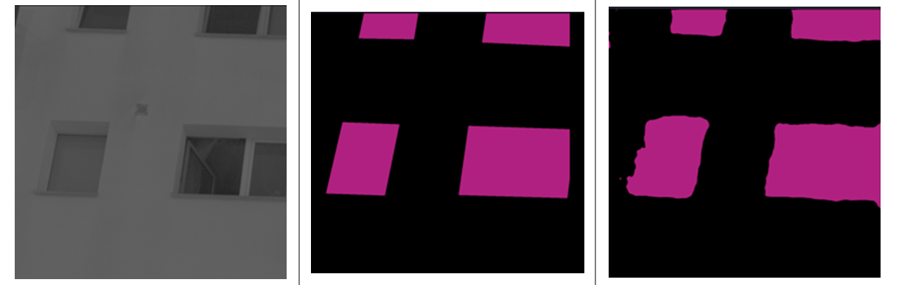
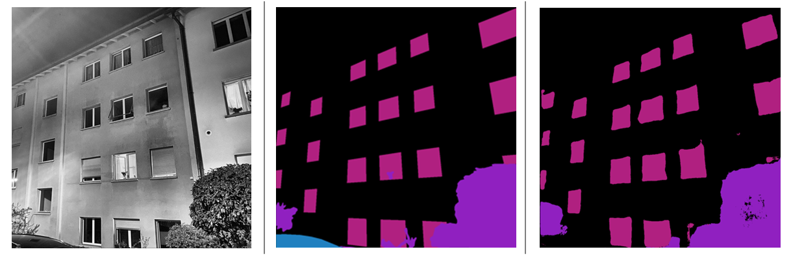
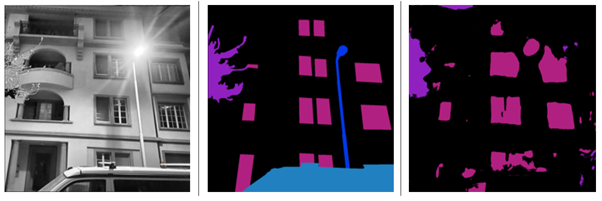

# Luminance Image Segmentation with U-Net

Pixel-level segmentation of night-time street scenes captured with a calibrated luminance camera. A U-Net, built and trained from scratch in PyTorch, finds lit windows (and other urban objects) in single-channel HDR images, so that light from private windows can be measured separately from street lighting.




**What's in here**

- Custom U-Net for 1-channel input, in two variants: a 5-class model (background, window, car, vegetation, streetlamp) and a binary window-only model
- Two-stage training: pretraining on a public night-time facade dataset converted to grayscale, then fine-tuning on 60 calibrated HDR luminance images from Berlin
- Patch pipeline for 6480 × 4860 images (1024 × 1024 tiles, 512 px overlap)
- Imbalance-aware losses (Focal + Dice, weighted BCE + Dice), mixed-precision training, early stopping
- Evaluation with IoU, Dice, pixel accuracy and confusion matrices

## Results

On the luminance test set, after fine-tuning:

| Model | Window IoU | Window Dice | Mean IoU |
|---|---|---|---|
| 5-class | 46.00 % | 63.02 % | 40.43 % |
| Window-only | **57.60 %** | **73.10 %** | 66.95 % |

- Training a dedicated window model clearly beats the multi-class one on the target class.
- Vegetation is segmented well (82.97 % IoU in the 5-class model). Cars and streetlamps are not learned at all, because they are rare and, without colour, glare and reflections look like lit windows.
- Fine-tuning on just 60 images still improved over the pretrained baseline, so features learned on ordinary photos transfer to luminance data.

## Quickstart

```bash
pip install torch torchvision albumentations segmentation-models-pytorch \
            opencv-python pillow numpy tqdm scikit-learn seaborn matplotlib
```

Set data paths in `src/config.py`, then run from inside `multiclass/` or `window_only/`:

| | 5-class | Window-only |
|---|---|---|
| Pretrain | `python training.py` | `python train_window.py` |
| Fine-tune | `python fine-tuning.py` | `python fine_tune_window.py` |
| Evaluate | `python evaluation.py` | `python evaluation_window_class.py` |

Preprocessing scripts (grayscale conversion, patching, mask conversion) are in `preprocessing/`. Trained on an NVIDIA A100 with batch size 32; lower `BATCH_SIZE` for smaller GPUs.

## Data

Datasets are not included. Pretraining used a grayscale-converted subset of [Dark Zürich](https://www.trace.ethz.ch/publications/2019/GCMA_UIoU/) (via Roboflow Universe). Fine-tuning used 60 HDR images from an LMK 6-30 imaging photometer, annotated by hand in CVAT. Masks are single-channel PNGs with IDs 0–4 (background, window, car, vegetation, streetlamp).

## Limitations

Small, imbalanced dataset; no colour information; glare from bright light sources; mostly frontal viewpoints; soft window edges.


## License

[MIT](LICENSE)
